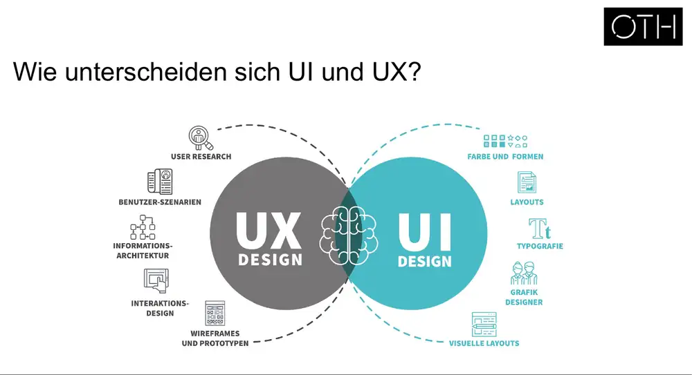
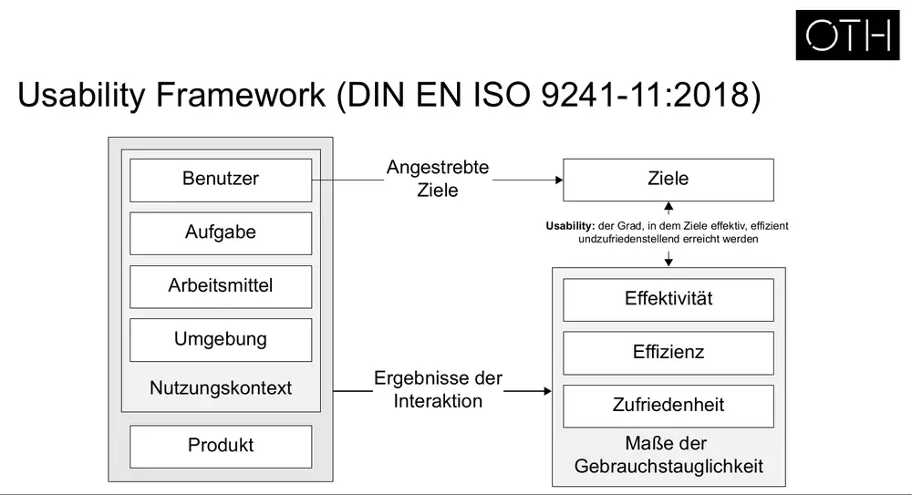
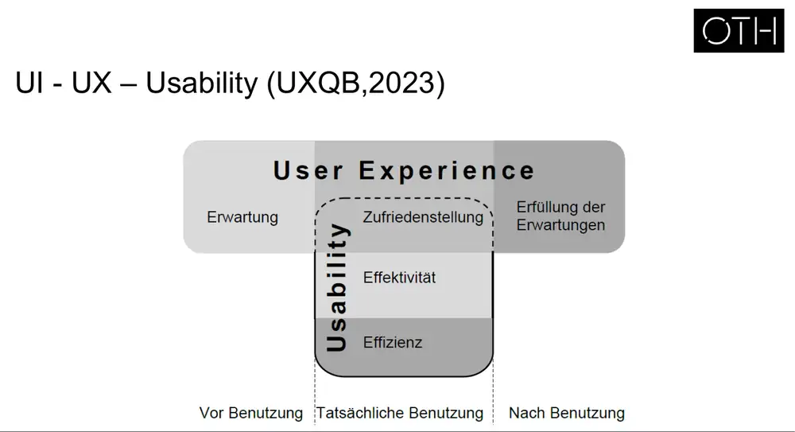

# HCI 03 – UX, Usability, Informationsverarbeitung & Wahrnehmung

## Gliederung
1. Aufwärmübung: Miller's Law & Chunking (F3–11)
2. Recap: Historie HCI/UI (F12–14)
3. Begriffe: User Experience (F15–27), Usability (F28–45), Abgrenzung UI/UX/Usability (F46–49)
4. Informationsverarbeitung & Wahrnehmungspsychologie (F50–64)
5. Gestaltgesetze (F65–79)
6. Teil 2: Teamübung Duolingo, Projektbriefing (F81–97)

---

## 1. Aufwärmübung: Miller's Law & Chunking (F3–11)
- Übung: Buchstabenfolge `ACFDDFUSCÖPDPDSUDP` kurz zeigen und merken lassen → kaum merkbar. Danach gruppiert als Parteinamen `CDU CSU FDP ÖDP SPD AFD` → leicht merkbar. Effekt: Chunking.
- **Miller's Law:** Eine durchschnittliche Person kann nur **7 ± 2** Gegenstände im Kurzzeitgedächtnis behalten. Die Kapazität hängt von Vorerfahrung und situativem Kontext ab.
- **Chunking (Gestaltungsregeln):**
  - Ungeordnete Informationen in bedeutungsvolle Einheiten strukturieren
  - Nicht mehr als ca. 7 Informationseinheiten
  - Einheiten räumlich voneinander abgrenzen (Ref.: Gesetz der Nähe, Goldstein 2015)
  - → Information wird verständlicher; gilt besonders bei viel Information
- [Bild F9: Formular „Bad“ = lange ungegliederte Feldliste vs. „Better“ = dieselben Felder in 3 beschriftete Gruppen aufgeteilt.]
- [Bild F10/11: „Wall of Text“ als ungegliederter Absatz vs. dieselbe Info mit Überschrift, Absätzen und hervorgehobenem Kernsatz: „the longer it is, the less of it people will read“.]

## 2. Recap: Historie von HCI und UI (F13–14)
- [Bild F13: Zeitleiste der Interfaces: Punch-cards (1960er) → Command Line (1970er) → GUIs (1980er) → Early Internet (1990er) → Modern Web (2000er) → Mobile First (2010er) → ??? (2020er).]
- [Bild F14: Pyramide „Deep tech opportunities build on top of each other“: Basis ML/AI (Data + algorithms → New Capabilities: Effizienz, Automatisierung), Mitte IoT (Hardware + sensors → New Devices: Tracking, Steuerung), Spitze AR/VR (Devices + maps → New Experiences: Immersion, Kollaboration). Unten „tech centric“, oben „user centric“.]

## 3. User Experience (F15–27)
- [Bild F16: Beispiele schlechter/guter Erfahrung: Glastür mit Griffen, aber Schild „PUSH“ (Griff signalisiert Ziehen); Trampelpfad neben dem angelegten Weg; Starbucks-Lieferwagen, dessen Schiebetür das Logo zu „SUCKS“ verdeckt.]
- [Bild F17: UX entsteht **vor**, **während** und **nach** der Nutzung, Beispiel Games: vorher Empfehlungen, Erwartungen, Plattformwahl; während Spielen, Emotionen, Support; nachher Aufbewahrung, Geschenk, Weiterverkauf/Entsorgung.]
- Beispiel Chewy (F18): Tierbedarf-Händler; Foto eines Hundes und Blumenstrauß mit Karte. (Interpretation: Chewy ist bekannt dafür, Kunden nach dem Tod eines Haustiers Blumen/Karten zu senden → UX geht über das Produkt hinaus.)

### Definitionen
| Quelle | Definition |
|---|---|
| Kaplan / NN Group (2024) | „User experience encompasses all aspects of the end-user's interaction with the company, its services, and its products.“ Stichworte: Meet customer needs; Simplicity and elegance; Seamless merging of services of multiple disciplines |
| ISO 9241-210:2019 | „A person's perceptions and responses that result from the use and/or anticipated use of a product, system or service.“ |
| UXQB (2016) | Wahrnehmungen und Reaktionen einer Person aus der tatsächlichen oder erwarteten Benutzung eines interaktiven Systems. UX **schließt Usability ein**; umfasst Gefühle, Meinungen, Bevorzugungen, Auffassungen, Leistungen **vor, während und nach** der Benutzung; hängt ab von Markenimage, Darstellung, Funktionalität, Systemleistung, interaktivem Verhalten, unterstützenden Fähigkeiten und Nutzungskontext |

- Video (F22): Don Norman zu UX – https://www.youtube.com/watch?v=9BdtGjoIN4E
- [Bild F23: Wort „vitamins“ in Holz geschnitzt; Bedeutung auf der Folie nicht erklärt.]

### Eigenschaften von UX (NN Group, F24)
| Value | Usability | Adoptability | Desirability |
|---|---|---|---|
| Is it useful? | Is it easy to use? | Is it easy to start using? | Is it fun and engaging? |

### UX-Modelle (F25–27)
- [Bild F25: Venn-Diagramm aus drei Kreisen: Technology, Business, Design.]
- [Bild F26: Rad mit Person im Zentrum; Segmente: Interaction Design, Information Architecture, Visual Design, Functionality, Usability, Typography, User Interface, Content Strategy.]
- **UI vs. UX (F27):** UX Design umfasst User Research, Benutzer-Szenarien, Informationsarchitektur, Interaktionsdesign, Wireframes & Prototypen. UI Design umfasst Farbe & Formen, Layouts, Typografie, Grafikdesign, visuelle Layouts. Beide überlappen.
  

## 4. Usability (F28–45)
- [Bild F29: Retro-Comic „Usability! It makes people not hate you!“; F30: Sitcom-Standbild (Big Bang Theory) – Auflockerung.]

### Definitionen
- **Rubin & Chisnell (2008):** A user „can do what he or she wants to do the way he or she expects to be able to do it, without hindrance, hesitation, or questions.“ Stichworte: Benutzbarkeit, Bedienung, Informationsfindung.
- **DIN EN ISO 9241-11:2018:** „Das Ausmaß, in dem ein interaktives System durch bestimmte Benutzer in einem bestimmten Nutzungskontext genutzt werden kann, um bestimmte Ziele **effektiv, effizient und zufriedenstellend** zu erreichen.“
  - Effektivität = Grad der Vervollständigung einer ausgeführten Arbeit
  - Effizienz = Ressourcenaufwand in Relation zum erreichten Ziel
  - Zufriedenheit = physische, kognitive und emotionale Erwartungen

### Messgrößen nach ISO 9241-11 (F33)
| Effektivität | Effizienz | Zufriedenheit |
|---|---|---|
| % User, die die Aufgabe erfolgreich abschließen | Zeit für die Durchführung der Aufgabe | Bewertungsskalen zur Zufriedenheit |
| % erreichte Ziele | Abgeschlossene Aufgaben pro Zeiteinheit | Nutzungsrate im Laufe der Zeit |
| Durchschnittliche Genauigkeit der abgeschlossenen Aufgabe | Kosten/Aufwand bezogen auf die Aufgabe | Häufigkeit von Beschwerden |

### Erweiterung ISO 9241-11:2018 (F34)
Usability ist relevant für: regelmäßige Nutzung; Erlernbarkeit (neue Nutzer); gelegentliche Nutzung (jede erneute Verwendung); Nutzung durch Personen mit breitestem Spektrum an Fähigkeiten; Minimierung von Risiken und Folgen von Benutzungsfehlern; Wartung (Wartungsaufgaben effektiv, effizient, zufriedenstellend).

### Usability Framework (ISO 9241-11:2018, F35)
- Nutzungskontext (Benutzer, Aufgabe, Arbeitsmittel, Umgebung) + Produkt → **Ergebnisse der Interaktion** → gemessen an Effektivität, Effizienz, Zufriedenheit (= Maße der Gebrauchstauglichkeit) im Vergleich zu den **angestrebten Zielen**.
- Usability = Grad, in dem Ziele effektiv, effizient und zufriedenstellend erreicht werden.
  

### Anwendung des Frameworks am Arbeitsplatz (F37–38): Checkliste Nutzungskontext
- **Benutzer:** Persönliche Angaben (Nutzertypen, Zielgruppe, sekundäre Benutzer) · Fähigkeiten & Wissen (Produkt-, System-, Aufgaben-, Organisationserfahrung, Training, Tastatur-/Eingabefähigkeiten, Qualifikationen, Sprachkenntnisse, Allgemeinwissen) · Persönliche Eigenschaften (Alter, Geschlecht, körperliche Fähigkeiten/Einschränkungen/Behinderungen, intellektuelle Fähigkeiten, Einstellung, Motivation)
- **Ziele:** Ziele, Teilziele
- **Umgebung (organisational):** Struktur (Arbeitszeiten, Gruppenarbeit, Arbeitsfunktion, Arbeitspraktiken, Unterstützung, Unterbrechungen, Management-, Kommunikationsstruktur, Vergütung) · Einstellungen & Kultur (Richtlinien zur Computernutzung, Organisationsziele, Arbeitsbeziehungen) · Arbeitsgestaltung (Flexibilität, Leistungsüberwachung, Leistungsfeedback, Arbeitstempo, Autonomie, Ermessensspielraum)
- **Arbeitsmittel:** Grundlegende Beschreibung (Produktidentifikation, -beschreibung, Hauptanwendungsbereiche, Hauptfunktionen) · Spezifikation (Hardware, Software, Materialien, andere Artikel)
- **Aufgaben:** Aufgabenzerlegung, Name, Häufigkeit, Dauer, Häufigkeit von Ereignissen, Flexibilität, körperliche/geistige Anforderungen, Abhängigkeiten, Ergebnis, Risiken durch Fehler
- **Technische Umgebung:** Konfiguration (Hardware, Software, Referenzmaterialien)
- **Physische Umgebung:** Arbeitsplatzbedingungen (atmosphärisch, auditiv, thermisch, visuell, Umweltinstabilität) · Arbeitsplatzgestaltung (Platz/Möbel, Benutzerhaltung, Standort) · Arbeitssicherheit (Gesundheitsrisiken, Schutzkleidung/Ausrüstung)

### Usability-Attribute nach Rubin & Chisnell (2008, F39)
| Attribut | Definition | Datenerhebung |
|---|---|---|
| Usefulness | Inwieweit ein Produkt den Nutzer beim Erreichen seines Ziels unterstützt, inkl. Bereitschaft, es überhaupt zu nutzen | quantitativ + qualitativ |
| Efficiency | Zeit, Genauigkeit und Vollständigkeit beim Erreichen des Ziels | quantitativ |
| Effectiveness | Inwieweit sich ein Produkt wie erwartet verhält | quantitativ + qualitativ |
| Learnability | Fähigkeit, das System nach einer definierten Zeit mit einem bestimmten Kompetenzniveau zu bedienen | qualitativ |
| Satisfaction | Subjektive Gefühle, Wahrnehmungen, Meinungen | qualitativ |
| Accessibility | Zugang zu Produkten/Services, besonders für Menschen mit (temporären oder permanenten) Einschränkungen | quantitativ + qualitativ |

### Usability-Attribute nach Krug (2014, F40)
Nützlich (erfüllt eine nötige Aufgabe?) · Erlernbar (finden Menschen heraus, wie es geht?) · Einprägsam (muss man es jedes Mal neu lernen?) · Effektiv (erledigt es die Aufgabe?) · Effizient (in angemessener Zeit und mit angemessenem Aufwand?) · Begehrenswert (wollen Menschen es haben?) · Begeisternd (macht es Spaß?)

### Beispiele (F41–45)
- Zitat Don Norman (F41): „When a device as simple as a door has to come with an instruction manual – even a one-word manual – then it is a failure, poorly designed.“
- **Usability vs. Bedienungsanleitung (Schmid & Maier 2017, F42):** [Bild: Diagramm mit drei Produkten A, B, C. Je höher die Usability, desto dünner die Bedienungsanleitung. Produkt A hat hohe Usability und ein dünnes Handbuch, Produkt C geringe Usability und ein dickes.]
- [F43: Überladenes Schweizer Taschenmesser = überladene Software-Oberfläche mit vielen Feldern/Tabs → zu viele Funktionen ≠ gute Usability.]
- [F44: Zwei frühe iPhone-Taschenrechner/Wähltastatur-Screens im Vergleich.]
- [F45: Standbild aus der Satiresendung extra3 (Gartenzwerg) – Kontext nicht erklärt.]

## 5. Abgrenzung UI – UX – Usability (F46–49)
- **Zeitliche Sicht (F47):**
  - **Vor der Nutzung:** Vorstellung über die Nutzung des Produkts, ohne es tatsächlich genutzt zu haben.
  - **Während der Nutzung:** Effektive und effiziente Aufgabenerledigung ohne Beeinträchtigungen. Das ist **Usability (ISO 9241-11)**.
  - **Nach der Nutzung:** Verarbeitung der erlebten Nutzung, emotionale Bindung zum Produkt (oder Distanzbildung).
  - Alle drei Phasen zusammen = **User Experience (ISO 9241-210)**.
- **UXQB-Modell (2023, F48):** UX umfasst Erwartung (vor Benutzung), Zufriedenstellung (während) und Erfüllung der Erwartungen (nach Benutzung). Usability liegt nur in der tatsächlichen Benutzung und besteht aus Zufriedenstellung, Effektivität und Effizienz. Die Zufriedenstellung ist die Schnittmenge von UX und Usability.
  
- [F49: Collage gängiger Darstellungen: UX/UI-Venn mit Usability in der Schnittmenge; UI = „what you design on the screen“, Usability = „quality of that interface for users“, UX = „totality of what the user experiences through all touchpoints“; UX als Oberbegriff über User Needs, User Interface, Usability.]

## 6. Informationsverarbeitung & Wahrnehmungspsychologie (F50–64)
- **Übung (F51–53):** Video „Selective Attention Test“: zählen, wie oft das Team in Weiß den Ball passt. Dazu Video „Whodunnit?“. Beide demonstrieren Unaufmerksamkeitsblindheit und Change Blindness. (Interpretation, die Videos sind auf den Folien nur benannt.)

### Mensch als Informationsverarbeitungssystem (F54)
- Eingabe → Verarbeitung → Ausgabe. Jede Aktion verändert die Umgebung → neuer Reiz.
- [Bild: Kreislauf Stimuli → (Perzeption) → Kognition → (Aktion) → Verhalten → Umgebung.]

| Wahrnehmungssystem | Organ | Empfindung |
|---|---|---|
| Visuell | Auge | Farbe, Helligkeit |
| Auditiv | Ohr | Tonhöhe, Lautstärke |
| Haptisch | Haut, Muskelspindel | Vibration, Druck, Stellung |
| Thermisch | Haut | Wärme, Kälte |
| Olfaktorisch | Nase | Geruch |
| Gustatorisch | Mund | Geschmack |

### Modell nach Card et al. (1986, F55)
- **Perzeptuelles System:** Sinne → Wahrnehmung → visueller, auditiver, haptischer Speicher
- **Kognitives System:** Arbeitsgedächtnis ↔ Langzeitgedächtnis → Kognition. Hier werden Reize interpretiert und Handlungen geplant.
- **Motorisches System:** motorischer Prozessor → Bewegung

### Modell nach Wickens & Holland (2000, F56)
Sensorische Informationsaufnahme & erste Interpretation (Auge, Ohr, Hand) → Denken, Problemlösen, Schlussfolgern, Entscheiden mit allen beteiligten Gedächtnisprozessen (Gehirn) → manuelle oder verbale Handlungsausführung (Hand, Mund).

### Model Human Processor (MHP, Card et al. 1983, F57)
Drei Subsysteme, die **sequenziell** durchlaufen werden:
| Subsystem | Funktion | Zykluszeit |
|---|---|---|
| Perzeptuell (P) | nimmt Stimuli aus der Umwelt auf | 100 [50–200] ms |
| Kognitiv (C) | rationale Verarbeitung | 100 [25–170] ms (Grafik: 70 [25–170]) |
| Motorisch (M) | Kontrolle von Aktionen | 100 [70–360] ms (Grafik: 70 [30–100]) |

[Bild: klassische MHP-Skizze: Mensch vor Bildschirm; Langzeitgedächtnis und Arbeitsgedächtnis (Visual/Auditory Image Store) mit Kapazitäts- und Zerfallswerten. Die Zahlen in der Grafik weichen teils vom Folientext ab, siehe Tabelle.]

- Video „HCI Psychologie“ (F58): NN/g, Hoa Loranger.

### Wahrnehmungspsychologie (Goldstein 2015, F59)
Teilgebiet der Psychologie. Sie untersucht den subjektiven Anteil der Wahrnehmung, den die objektive Sinnesphysiologie nicht erklärt. Die Sinne nehmen sehr viel auf, bewusst wahrgenommen wird deutlich weniger.

### Stufenmodelle der Wahrnehmung
- **Bottom-up (F60):** Der Stimulus ist immer das erste Ereignis. Ausgehend vom Reiz folgen Verarbeitungsschritte (Processing → More → Even more processing). Beispiel unbekanntes/kaum lesbares Wort (CAPTCHA): Es gibt keinen Rückgriff auf das Langzeitgedächtnis, nur Verarbeitung.
- **Top-down (F61):** Höhere Verarbeitungsschritte beeinflussen die unteren direkt. Beispiel: Dasselbe Zeichen wird zwischen A und C als „B“, zwischen 12 und 14 als „13“ gelesen. → Vorwissen beeinflusst die Wahrnehmung.

### Wahrnehmungseffekte und Gestaltungshinweise
| Effekt | Beschreibung | Unterstützung im Design |
|---|---|---|
| Tunnelblick / selektive Aufmerksamkeit (F62) | Menschen fokussieren bestimmte Sektionen/Stimuli und übersehen andere | Wichtige Infos prominent machen (Von-Restorff-Effekt); in den visuellen Fokus setzen |
| Change Blindness (F63) | Kleine Änderungen außerhalb des Fokus werden übersehen, z. B. ein falsch ausgefülltes Formularfeld nach Refresh → Fehler, Frust | Wenige Änderungen; Änderungen im fokalen Umfeld; Änderungen visuell prominent |

[Bild F62: zwei fast identische Webseiten-Screenshots mit Jahreszahl 2000. F63: zwei fast identische Fotos einer Skulptur → Unterschied finden.]
- Video (F64): Working Memory and External Memory (NN/g) – https://www.youtube.com/watch?v=qV5gSyfi4p8

## 7. Gestaltgesetze (F65–79)
| Gesetz | Demonstration auf der Folie | UI-Bedeutung (Interpretation) |
|---|---|---|
| Ähnlichkeit (F65) | Punkteraster mit abwechselnd blauen und gelben Spalten → werden als Spalten gruppiert; Smartphone-Mockup mit gleichfarbigen grünen Elementen | Gleich aussehende Elemente werden als zusammengehörig verstanden |
| Nähe (F66–67) | Gleiche Punkte mit kleinem horizontalem Abstand → Zeilen; mit kleinem vertikalem Abstand → Spalten | Abstand gruppiert (Grundlage für Chunking) |
| Prägnanz / gute Gestalt (F68) | Ein leerer Kreis und ein gelber Punkt fallen im blauen Raster sofort auf; Mockup mit blauem Button | Abweichendes/einfaches Element sticht heraus (Call-to-Action) |
| Geschlossenheit (F69) | Vier Ecken werden als Rechteck wahrgenommen | Unvollständige Formen werden ergänzt |
| Gemeinsame Region (F70) | Ein Rahmen um 4 Punkte gruppiert diese über Farbgrenzen hinweg | Karten/Container gruppieren Inhalte |
| Gemeinsames Schicksal (F71) | Versetzte Reihen → Elemente mit gleicher Ausrichtung/Bewegung gehören zusammen | Gemeinsam bewegte Elemente gehören zusammen |
| Kontinuität (F72) | Punkte auf zwei sich kreuzenden Linien werden als zwei Linien gesehen | Elemente auf einer Linie/Kurve werden als Folge gelesen |
| Verbundenheit (F73) | Mit Linien verbundene Punkte werden als Einheit gesehen, stärker als Farbe | Verbindungslinien (z. B. Stepper) gruppieren |

Anwendungsbeispiele (F74–79; welches Gesetz zu welchem Beispiel gehört, sagen die Folien nicht):
- iOS-Taschenrechner: Farbgruppen für Zahlen, Operatoren, Funktionen (Ähnlichkeit)
- Banking-App: Kontostand im Kreis, darunter gruppierte Konten
- OTTO-Produktseite (Apple Watch): Preisbox, Warenkorb-Button, Produktinfos in Regionen
- Produktraster Baby-Artikel und Kindersitze: gleichartige Kacheln (Ähnlichkeit, Nähe)
- O2-Checkout „Mein Warenkorb“: 4-Schritte-Fortschrittsanzeige (Verbundenheit, Kontinuität)

---

# Teil 2 (F81–97): Teamübung & Projektbriefing

## Teamübung Duolingo (F84–90)
- Auftrag: Videos der App ansehen (optional App herunterladen). Im Team positive und negative Aspekte sammeln, ca. 20 min.
- [Bilder: Duolingo-Maskottchen (grüne Eule); Screens: Onboarding/App-Start, „It's so good to see you again!“ mit CONTINUE-Button, Übung „Complete the sentence“ (Französisch: un/une, garçon/fille), Dashboard mit Unit-1-Fortschritt und Lektionen (Basics 1, Greetings, Basics 2), Statusleiste mit Streak/Gems/Herzen.]

## Projektbriefing (F92–96)
**Allgemein:** Projektgruppen à 4 Personen durchlaufen das Usability Engineering Framework an einer konkreten Produktentwicklung. Der Aufwand richtet sich nach der Teamgröße. Erwartete Schritte:
1. Planung des Usability Engineering Frameworks
2. Nutzungskontext verstehen und beschreiben
3. Nutzungsanforderungen ableiten und spezifizieren
4. Gestaltungslösungen entwickeln (LoFi → HiFi)
5. Evaluation & Optimierung per Usability Tests

Dokumentation als **Pitchdeck** mit allen Methoden (auch frühe Phasen), Erkenntnissen und Entscheidungen.

**Thema:** Digitales UX-Konzept zu **„Lebensqualität in Regensburg“**. Zielgruppen und Anwendungskontext frei wählbar.

**Abgabe bis 20.01.2027, 23:59 Uhr** (eine Person pro Team lädt hoch, Link folgt):
1. Finale Projektdokumentation als zusammenhängendes PDF (PPT-Template wird gestellt)
2. Evaluierter und optimierter Prototyp als lokale Figma-Datei
3. Video eines Usability Tests

**Pro Teammitglied:**
- 1 Primary-Research-Methode (z. B. Interview, Umfrage, Fokusgruppe)
- 1 Secondary-Research-Methode (z. B. Mitbewerberanalyse, Persona, Task Analysis)
- 1 konkrete „Funktion“ im Prototyp
- 2 Usability Tests des HiFi-Prototyps (= 8 Tests bei 4 Personen). Gefordert ist ein Video von einem der Tests.
- Arbeitsanteile zu Beginn der Doku tabellarisch aufschlüsseln. Bei gleichmäßiger Arbeit genügt ein Vermerk. → **Teamnote**

**Bewertungskriterien:**
- Korrekte Vorgehensweise und Methodenanwendung im Framework (ausreichend viele Methoden)
- Ableitung und Definition konkreter Nutzungsanforderungen
- LoFi-Prototyp auf Basis von Scribbles, Card Sorting bzw. Tree Testing, Wireframes, Informationsarchitektur/Navigationsstruktur
- Evaluation des LoFi-Prototyps (Meilenstein Zwischenpräsentation)
- Style Guide
- HiFi-Prototyp mit ausreichend konkreten Features
- Evaluation des HiFi-Prototyps per Usability Tests (min. 2 Teilnehmende pro Teammitglied)
- Nachvollziehbares Testvideo (z. B. Split Screen)
- Optimierung des HiFi-Prototyps
- Nachvollziehbare Nutzung von Design-/Usability-Guidelines
- Formale und sprachliche Ausführung des Pitchdecks

## Arbeitsauftrag bis nächste Woche (F97)
- Organisatorisches klären: Zeitmanagement, Jour fixe, Kommunikation, Fortschrittsdokumentation, Dokumentenablage
- Thematisches Brainstorming zu **Problemräumen**: Welche Kontexte? Welche Zielgruppen? **Noch nicht an Lösungen denken!**

Nächster Termin: 26.10.2026, Raum D003.

## Quellen (auf den Folien genannt)
Card et al. (1983, 1986) · DIN EN ISO 9241-11:2018 · ISO 9241-210:2019 · Goldstein (2015) · Kaplan/NN Group (2024) · Krug (2014) · Miller · Norman · Rubin & Chisnell (2008) · Schmid & Maier (2017) · UXQB (2016, 2023) · Wickens & Holland (2000)
