# HCI 04 – Designprozesse & Usability Engineering Framework

## Gliederung
1. Recap (F3–13)
2. Prozesse: Vor-/Nachteile, Designprozess-Modelle (F14–24)
3. Software-Entwicklungsmodelle: Phasen, Wasserfall, iterativ, inkrementell, agil (F25–36)
4. **DIN EN ISO 9241-210 – Usability Engineering Framework / HCD-Prozess** (F37–51)
5. **Usability Engineering vs. Software Engineering (Mapping)** (F52–58)
6. Methoden im Usability Engineering / Methodenwahl (F59–77)
7. Phase 1: Nutzungskontext verstehen und beschreiben, Ethik (F78–85)
8. Teil 2: Einverständniserklärung, Primary/Secondary Research, Interviews (F87–105)

**Kernaussage der Vorlesung:** Usability Engineering beginnt beim Verständnis des Problems, nicht bei Technik oder Lösung. Es muss sich in das jeweilige Software-Entwicklungsmodell eingliedern. Design bedeutet immer Kompromisse.

---

## 1. Recap (F3–13)
- [F3/F4: Fotos einer Toilettentür mit Bullauge, die beim Öffnen kippt oder aus den Angeln fällt. Beispiel für schlechtes Design im Alltag.]
- Wiederholt aus HCI_03: Chunking, UI vs. UX, ISO 9241-11 (Effektivität = Grad der Vervollständigung; Effizienz = Ressourcenaufwand, z. B. Zeit, Kosten, **kognitive Beanspruchung**; Zufriedenheit), UI-UX-Usability-Zeitstrahl, Informationsverarbeitung, MHP, Gestaltgesetze (Ähnlichkeit, Nähe, Prägnanz, Geschlossenheit, Kontinuität, gemeinsames Schicksal, gemeinsame Regionen, Verbundenheit).

## 2. Prozesse (F14–24)

### Übung (F15)
Im Team: je mind. 3 Vor- und Nachteile von Entwicklungs-/Designprozessen sammeln. Welche Phasen sollte ein Entwicklungsprozess haben? 10–15 min.

### Vorteile von Prozessen (F16)
- Jedes Projekt ist individuell. Standardisierte Prozesse helfen, fokussiert auf das Produkt hin zu arbeiten.
- Sie fördern nutzer- bzw. menschzentriertes Arbeiten, da sie auf die Bedürfnisse der Nutzenden ausgerichtet sind.
- Sie fördern Kreativität und Innovation, weil sie einen Rahmen für Ideen, Experimente und unkonventionelle Lösungen bieten.
- Effizienzsteigerung bei Zeit und Ressourcen
- Qualitätssicherung durch systematische Prüfung und Bewertung → Fehler früh erkennen und beheben
- Bessere Zusammenarbeit zwischen Teams und Disziplinen sowie bessere Kommunikation mit Stakeholdern
- Vorteile gegenüber Wettbewerbern

### Nachteile von Prozessen (F17)
- Mehr Bürokratie und zusätzliche Komplexität
- Rigide Prozesse schränken die Kreativität ein (Prozesstreue > unkonventionelle Lösungen)
- Fehlende Flexibilität bei sich ändernden Anforderungen
- Stark standardisierte interne Abläufe können die Benutzerorientierung einschränken

### Designprozess-Modelle im Überblick

**Double Diamond (British Design Council, 2019, F18)**
- Challenge → **Discover** (divergent) → **Define** (konvergent) → **Develop** (divergent) → **Deliver** (konvergent) → Outcome
- Erster Diamant = Problemraum, zweiter = Lösungsraum. Gestrichelte Rückpfeile zeigen die Iteration.
- Mitte: **Design Principles**: 1. Be People Centered, 2. Communicate (Visually & Inclusively), 3. Collaborate & Co-Create, 4. Iterate, Iterate, Iterate. **Methods Bank**: Explore, Shape, Build.
- Rahmen: **Engagement** (Verbindungen und Beziehungen zwischen Bürgern, Stakeholdern, Partnern aufbauen) und **Leadership** (Bedingungen für Innovation schaffen: Kulturwandel, Skills, Mindset).
  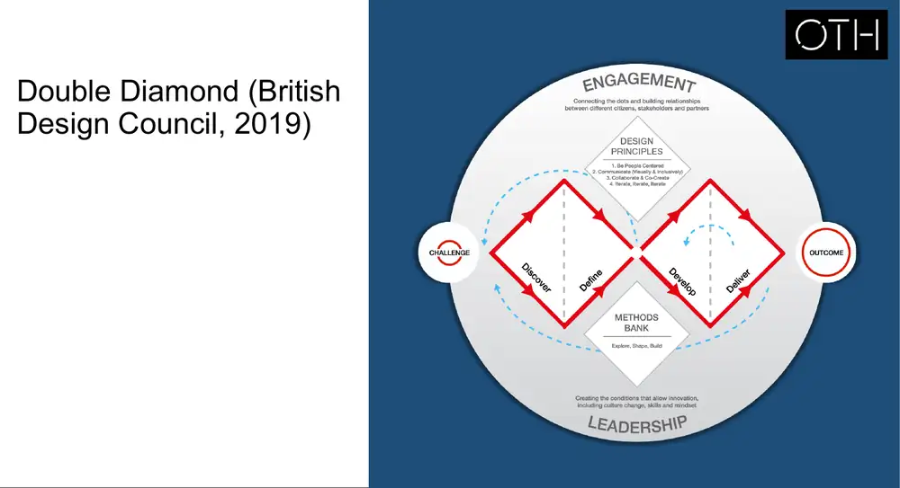

**Usability Engineering Lifecycle (Mayhew, 2010, F19)**
- **Requirements Analysis:** User Profile, Contextual Task Analysis, Platform Capabilities & Constraints, General Design Principles → Usability Goals → Style Guide
- **Design/Testing/Development** in drei Ebenen:
  - Level 1: Work Reengineering → Conceptual Model Design → CM Mockups → Iterative CM Evaluation → „Eliminated major flaws?“ (nein = zurück)
  - Level 2: Screen Design Standards → SDS Prototyping → Iterative SDS Evaluation → „Met usability goals?“
  - Level 3: Detailed UI Design → Iterative DUID Evaluation → „Met usability goals?“
  - Danach „All functionality addressed?“ (nein = zurück zur Requirements Analysis). Style Guides werden auf jeder Ebene fortgeschrieben.
- **Installation:** Installation → User Feedback → „All issues resolved?“ → Done, sonst Enhancements
  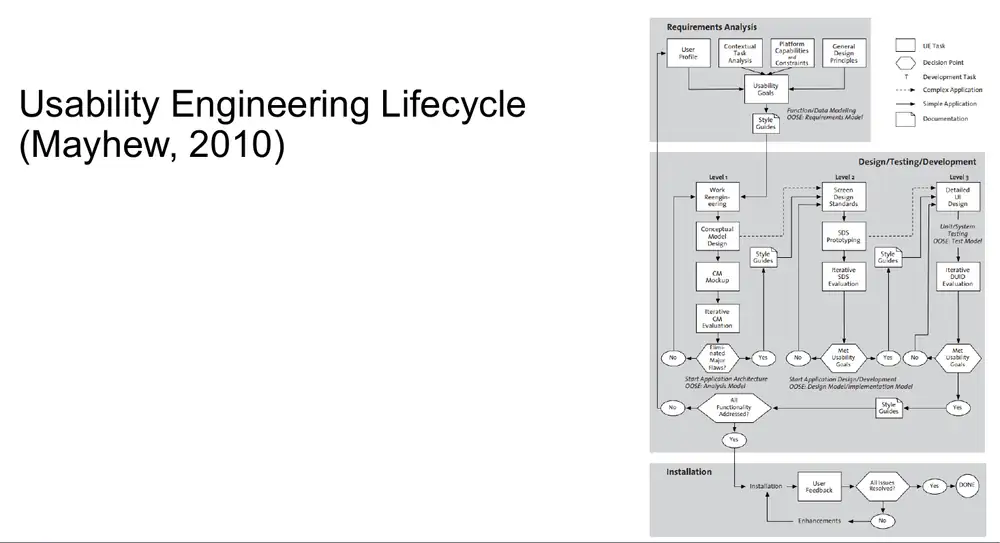

**Design Process (Lawson, 1980, F20)**
- Problem → Lösung über ein ineinander verschränktes, zickzackförmiges Band aus **Analysis, Synthesis, Evaluation**. Die Aktivitäten wechseln sich ständig ab und laufen nicht linear.
  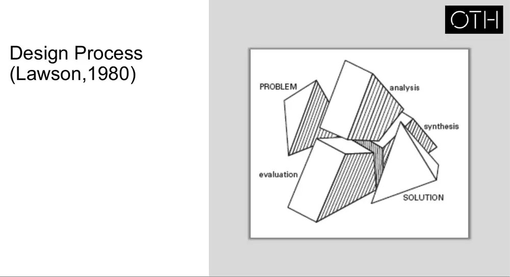

**Pervasive Usability Process (Brink et al., 2010, F21)**
- Linear: 1. Requirements Engineering → 2. Conceptual Design → 3. Mockups and Prototypes → 4. Production → 5. Launch. **Evaluation** ist mit jeder Phase bidirektional verbunden, also durchgängig („pervasive“).

**User Centered UX Design Process (F22)**
| Phase | Tätigkeit (Doing) | Output |
|---|---|---|
| Discover | Stakeholder Interview, User Research (Real Users) | Business Requirement (Brand Vision, Goals & Objectives, Target Audience, Success Metrics, Competitors); User Personas (Motivations, Goals, Needs, Triggers) |
| Define | Creative Ideation, Experience Mapping | Idea (Campaign/Product); User Journey (Source, CTA, Core Mechanism) |
| Design | Requirement Gathering, UX Design | User Flow (Task Analysis, Feature Analysis); Sitemap & Prototype (IA, UI) |
| Validate | Usability Testing (Real Users), Rückpfeil zu Design | Validated Prototype |
| Develop | Production | Graphic Design, Code → Launch |

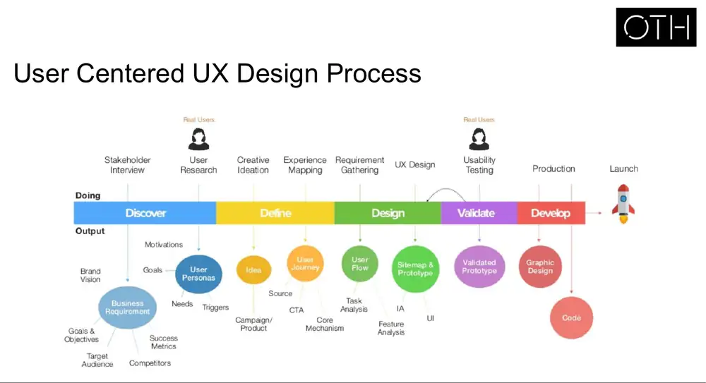

**Human-Centered Design Process (F23)** – wird später für das Mapping genutzt
- Briefing → **Problem space:** Research → Define → **Synthesis** → **Solution space:** Ideate → Prototype → Test (Iteration Test ↔ Ideate) → Engineering
- Klammer darunter: User Centered Design
  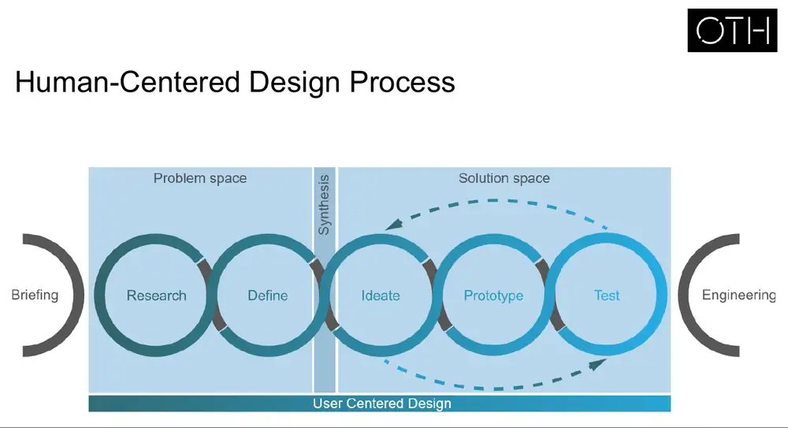

**Weitere UCD-Varianten (F24):** [Collage mehrerer Prozessgrafiken aus dem Netz, alle nach demselben Grundmuster: Understand/Research → Analyze → Design/Sketch/Prototype → Test/Validate → Launch/Develop → Analyze again. Beispiele: „Product definition → Research → Analysis → Design → Validation“; „Strategy → Discovery → Analysis → Design → Production“; „Research → Empathize → Create → Test → Develop“.]
→ Kernpunkt (Interpretation): Die Namen der Phasen unterscheiden sich, der Ablauf ist überall gleich: verstehen → definieren → gestalten → testen → iterieren.

## 3. Software-Entwicklungsmodelle (F25–36)

### Typische Phasen eines Entwicklungsprojekts (F25–31)
Requirements → Design → Implementation → Verification → Deployment → Maintenance

| Phase | Inhalt |
|---|---|
| Requirements | Ausgangspunkt: Ideen, Wünsche, Vorstellungen. Klären und Konkretisieren von Aufgabe, Scope und Restriktionen (Zeit, Budget, Hardware/Software) |
| Design | Funktionales Konzept: relevante Daten (was wird angezeigt), Funktionen, Ereignisse, auf die das System reagiert, UI-Beschreibung (Formulare, Menüs, Listen), Integration in organisatorische Abläufe. Ggf. Objektmodell mit allen Klassen, Datei-/Datenbankstrukturen, Datenverteilung (Client/Server) |
| Implementation | Umsetzung gemäß technischer und funktionaler Spezifikation |
| Verification | Test auf Fehlerfreiheit, anschließend Freigabe |
| Deployment | Beginnt direkt nach der Freigabe: Release, Install & Activate, Deactivate, Adapt, Update, Version Tracking, Uninstall, Retire |
| Maintenance | Fortlaufende Wartung (Bugfixing, neue Features) |

### Vorgehensmodelle
| Modell | Konzept | Probleme |
|---|---|---|
| **Wasserfall** (F32) | Phasen werden sequenziell abgearbeitet. Metapher: Wasser fließt nur nach unten, kein Rücksprung. Jede Phase wird vollständig fertiggestellt. | Großer Abstand zwischen Design und Deployment: Neue Anforderungen kommen, wenn das Design schon freigegeben ist. Nicht alle Anforderungen lassen sich vorab klären, manche ergeben sich erst aus der Nutzung. |
| **Iterativ** (F33) | Erlaubt Modifikation auf Basis von Erfahrungen aus früheren Versionen. Änderungsaufwand wird akzeptiert und eingeplant (z. B. Rational Unified Process, RUP). [Bild: Initial Planning → Zyklus Requirements → Design → Implementation → Verification → zurück; Ausgang Deployment] | – |
| **Inkrementell** (F34) | System wird in Pakete zerlegt. Jedes Paket wird sequenziell als eigenes Release entwickelt und in die bestehenden integriert, dann folgt das nächste. Kein „Big Bang“. [Bild: mehrere hintereinander geschaltete Mini-Wasserfälle, je ca. 4–6 Monate] | Annahme, dass das Design jedes Releases beim ersten Versuch gelingt. Umarbeitung ist im Konzept nicht vorgesehen. |
| **Agil, z. B. Scrum** (F35) | Verkürzt die Entwicklungszyklen weiter. [Bild Scrum-Zyklus: Product Backlog → Sprint Planning → Sprint Backlog → Daily Scrum → Potentially Shippable Product Increment → Sprint Review → Sprint Retrospective; Product Backlog Grooming] | – |

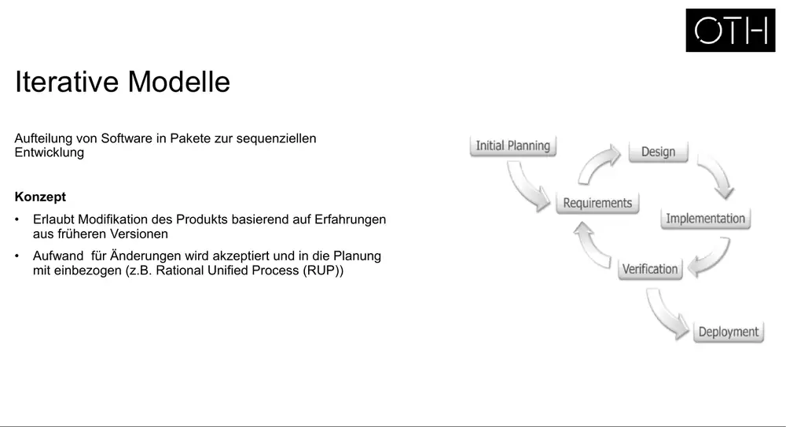
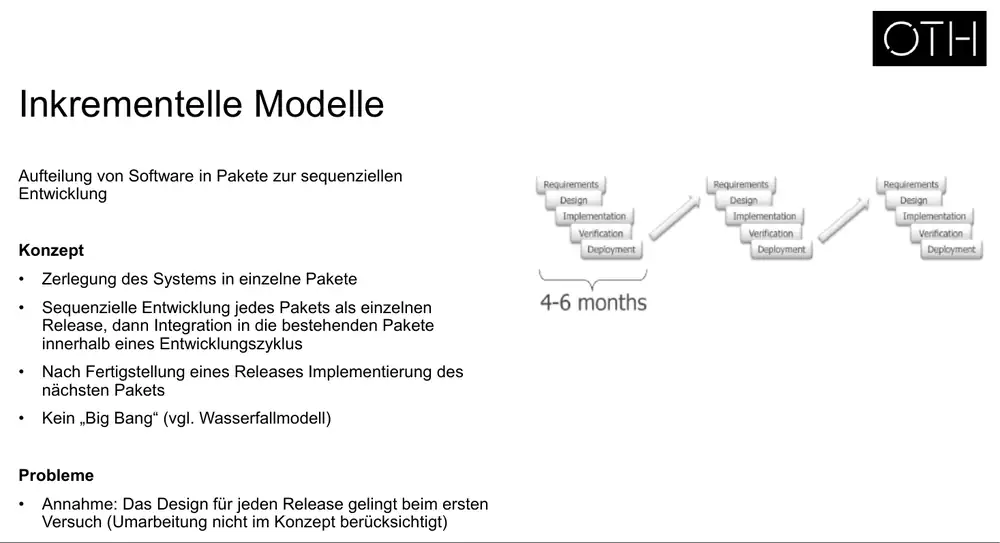
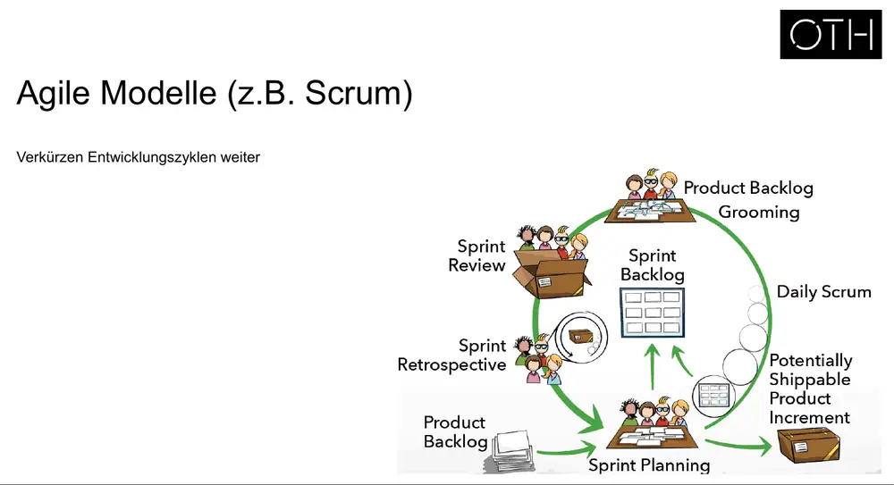

**Aber (F36):** Die Tätigkeiten bleiben immer gleich: **Analyse, Design, Implementierung, Test**. Es ändern sich nur Anordnung und Abfolge im Projektverlauf.

## 4. DIN EN ISO 9241-210 – Human-Centered Design / Usability Engineering Framework (F37–51)

### Begriffe (F38)
| Begriff | Definition |
|---|---|
| Accessibility | Barrierefreiheit: Wie gut ein Produkt, eine Dienstleistung oder Umgebung von Menschen mit unterschiedlichen Fähigkeiten genutzt werden kann |
| Context of use | Nutzungskontext: Nutzende, ihre Aufgaben, Geräte und Materialien sowie physische und soziale Umgebung |
| Effectiveness | Wie genau und vollständig Nutzende festgelegte Ziele erreichen |
| Efficiency | Eingesetzte Ressourcen (Zeit, Aufwand), um Ziele genau und vollständig zu erreichen |
| Ergonomics | Wissenschaft und Anwendung der Erkenntnisse über die Wechselwirkungen zwischen Menschen und Systemelementen, um menschliches Wohlbefinden und Systemleistung zu verbessern |
| Goal | Beabsichtigtes Ergebnis einer Handlung |
| Human-centred design | Ansatz zur Entwicklung interaktiver Systeme, bei dem Nutzung sowie Ergonomie- und Usability-Erkenntnisse im Mittelpunkt stehen |
| Interactive system | Kombination aus Hardware, Software und/oder Dienstleistungen, die Eingaben entgegennimmt und Ausgaben kommuniziert |
| Prototype | Repräsentation eines (Teils eines) interaktiven Systems, nutzbar für Analyse, Gestaltung, Evaluation |
| Satisfaction | Abwesenheit von Unbehagen und positive Einstellung gegenüber der Nutzung |
| Stakeholder | Person/Organisation mit Interesse, Anspruch oder berechtigtem Anliegen bezüglich des Systems |
| Task | Tätigkeiten, die zum Erreichen eines Ziels nötig sind |
| Usability | Gebrauchstauglichkeit: Ausmaß, in dem ein System von bestimmten Nutzenden in einem bestimmten Nutzungskontext effektiv, effizient und zufriedenstellend zur Erreichung festgelegter Ziele verwendet werden kann |
| User | Person, die mit einem Produkt interagiert |
| User experience | Wahrnehmungen und Reaktionen aus tatsächlicher oder erwarteter Nutzung, u. a. Emotionen, Überzeugungen, Wahrnehmungen, Verhalten |
| User interface | Alle Soft- und Hardwarekomponenten, die Informationen und Bedienelemente bereitstellen |
| Validation | Objektiver Nachweis, dass die Anforderungen für den **vorgesehenen Einsatzzweck** erfüllt sind (richtiges System) |
| Verification | Objektiver Nachweis, dass **festgelegte Anforderungen** erfüllt sind (System richtig gebaut) |

### Prozess zur Gestaltung gebrauchstauglicher Systeme (F39) – zentrales Modell
Ablauf (Kreislauf):
1. **Planung des human-centered Designprozesses**
2. **Den Nutzungskontext verstehen und beschreiben**
3. **Die Nutzungsanforderungen spezifizieren**
4. **Gestaltungslösungen entwickeln, die die Nutzungsanforderungen erfüllen**
5. **Gestaltungslösungen aus der Benutzerperspektive evaluieren**
6. → Iteration, soweit die Evaluierungsergebnisse Bedarf aufzeigen (Rücksprung zu 2, 3 oder 4)
7. → Ende: **Gestaltungslösung erfüllt die Nutzeranforderungen**

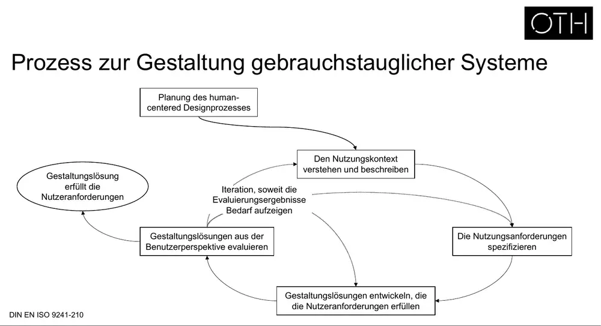

### Die Prozessschritte im Detail (jeweils „Wie?“ / „Warum?“)

| Schritt | Aktivität | Wie? | Warum? |
|---|---|---|---|
| Planung (1/2) | Abgestimmtes Methodenset | Methoden für jeden Prozessschritt vorab (a priori) auswählen | Ohne verbindliche, von allen akzeptierte Methoden steigt das Risiko subjektiver Designentscheidungen statt Entscheidungen auf Basis validierter Anforderungen, Szenarien und Testergebnisse. Beauftragung Dritter wird besser planbar. |
| Planung (2/2) | Festlegung von Ressourcen | Ressourcen (Personen, Zeit, Material) gemäß Projekt (Zielgruppe, Inhalt, Umfang) bestimmen und kommunizieren | Zeit-, Kosten- und Einsatzplanung |
| Nutzungskontext | Beschreibung des Nutzungskontexts | Benutzer aller Benutzergruppen, ihre Arbeitsaufgaben, Arbeitsmittel (HW, SW, Materialien), physischer und sozialer Kontext | Ohne sie basiert das ganze Projekt auf Annahmen. Aufgaben, Erfordernisse und Nutzungsanforderungen lassen sich nur auf Basis einer validen Kontextbeschreibung identifizieren. |
| Anforderungen (1/2) | Nutzungsanforderungen spezifizieren | Ermittelte Erfordernisse auswerten: Welche Systemunterstützung ist aus Nutzersicht nötig? | Nutzungsanforderungen beschreiben **nicht die Lösung**, sondern die Handlungsmöglichkeiten der Nutzenden, die die Lösung unterstützen muss. Ohne sie sind Lösungen nicht validierbar. Sie sind **feature-unabhängig**. |
| Anforderungen (2/2) | Nutzungsanforderungen priorisieren | Im Team nach Relevanz für Nutzende und Umsetzbarkeit (Kosten/Nutzen) priorisieren | Um Produktversionen wirtschaftlich zu planen |
| Gestaltung (1/5) | Interaktionsspezifikation | Interaktionsabläufe für alle Aufgaben aus dem Nutzungskontext modellieren. Nutzungsszenarien enthalten pro Aufgabe die Teilaufgaben und Aktionen aus Nutzersicht. | Bevor man ein UI beschreiben kann, muss feststehen, wie Nutzende ihre Aufgaben mit dem System erledigen: Welche Aktionen sind nötig, welche Systemreaktionen erwartungskonform? |
| Gestaltung (2/5) | Informationsarchitektur | Navigationspfade identifizieren, Navigationsstrukturen modellieren, Terminologie für Interaktionsobjekte festlegen | Basis für eine geeignete Menüstruktur. Ohne IA entstehen undurchschaubare, nicht erwartungskonforme Menüs. |
| Gestaltung (3/5) | (auf den Folien nicht enthalten) | – | – |
| Gestaltung (4/5) | Prototyping | **LoFi:** skizzenhaft, nicht auf der Zielplattform, früh. **HiFi:** plattformspezifisch, bildet Interaktionen ab, ggf. mit Gestaltungsrichtlinien. | Verschiedene Entwürfe ermöglichen den Vergleich von Lösungsansätzen und sind Voraussetzung für Usability Tests |
| Gestaltung (5/5) | UI-Gestaltungsrichtlinien | Produktspezifischer Gestaltungsrahmen und Guidelines auf Basis der Analyse bestehender Produkte, ISO-Standards, Styleguides, Corporate-Design-Vorgaben | Rahmen für das Design; Erwartungskonformität |
| Evaluation (1/2) | Entwicklungsbegleitende Usability Tests | Nutzertests mit Prototypen, Ergebnisse erfassen und an verantwortliche Rollen kommunizieren | Ohne sie steigt das Risiko einer Fehlentwicklung dramatisch. Kostengünstige Absicherung und Vervollständigung der Anforderungen, Qualitätssicherung. Frühes Feedback minimiert Probleme bei und nach Auslieferung. |
| Evaluation (2/2) | Quantitative Evaluierung | Nutzertests für objektive Leistungsdaten: Zeiten, Fehlerraten, Abbruchraten; auch Wettbewerbsanalysen | Quantitative Basis zum Vergleich von Versionen und mit Konkurrenzprodukten |

### Case Study: Warum es wichtig ist, die Nutzer zu verstehen – „Embrace“ Infant Warmer (F43)
- Hindernis 1: hohe Säuglingssterblichkeit in Entwicklungsländern, obwohl Brutkästen vorhanden wären
- Hindernis 2: große Entfernung zu Krankenhäusern (> 30 km), kein Zugang zu Brutkästen
- Hindernis 3: Mütter müssen nach wenigen Tagen zurück ins Dorf, obwohl das Kind noch in den Inkubator müsste
- Leitfrage: „Wie können wir die Überlebensrate der Säuglinge steigern, auch wenn Eltern sich die Behandlung nicht mehr leisten können?“
- Idee: kostengünstiger, transportabler Babywärmer (schlafsackartig). Erfolg: Einsatz in mehreren Ländern, 3000+ gerettete Neugeborene, Partnerschaften mit NGOs und GE Healthcare.
- Lehre (Interpretation): Die Lösung (kein billigerer Inkubator, sondern ein mobiler Wärmer) ergab sich erst aus dem Verständnis des realen Nutzungskontexts.

## 5. Usability Engineering vs. Software Engineering – Mapping (F52–58)
Die Folien zeigen, wie sich die Schritte des ISO-9241-210-Frameworks in gängige Software-Modelle einordnen. Farbige gestrichelte Pfeile verbinden SE-Phasen mit Framework-Schritten:

| SE-Modell | Zuordnung (aus Pfeilen abgelesen) |
|---|---|
| **Wasserfall** (F53) | Requirements → Planung, Nutzungskontext, Nutzungsanforderungen · Design → Gestaltungslösungen entwickeln **und** evaluieren · Verification → Gestaltungslösungen evaluieren |
| **Iterativ** (F54) | Initial Planning → Planung · Requirements → Nutzungskontext, Nutzungsanforderungen · Design → entwickeln + evaluieren · Verification → evaluieren. Die UE-Schritte wiederholen sich mit jeder Iteration. |
| **Inkrementell** (F55) | wie Wasserfall, aber pro Inkrement (zwei hintereinander geschaltete Mini-Wasserfälle) |
| **HCD-/UCD-Prozess** (F56, Folientitel ebenfalls „Inkrementelles Modell“) | Briefing → Planung · Research → Nutzungskontext · Define → Nutzungsanforderungen · Ideate + Prototype → Gestaltungslösungen entwickeln · Test → evaluieren · Engineering → Gestaltungslösung erfüllt Nutzeranforderungen |

Hinweis: Die Zuordnungen sind aus den Pfeilrichtungen abgelesen. Bei überlappenden Pfeilen können einzelne Verbindungen ungenau sein, siehe Bilder.
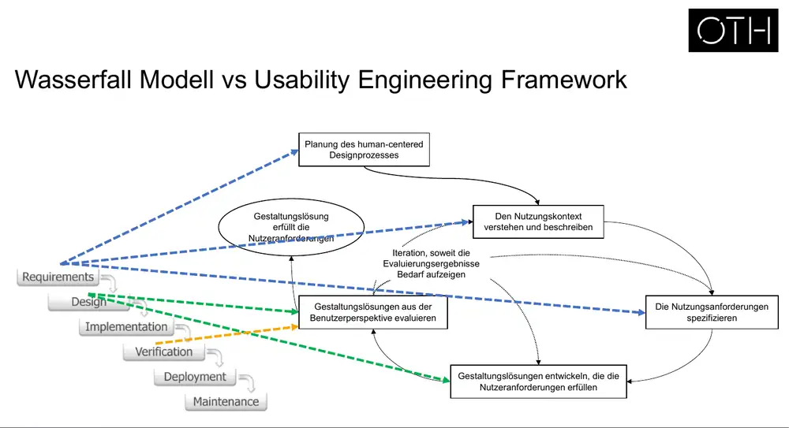
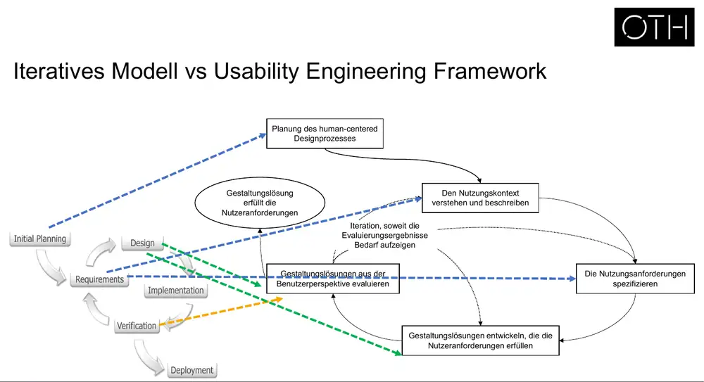
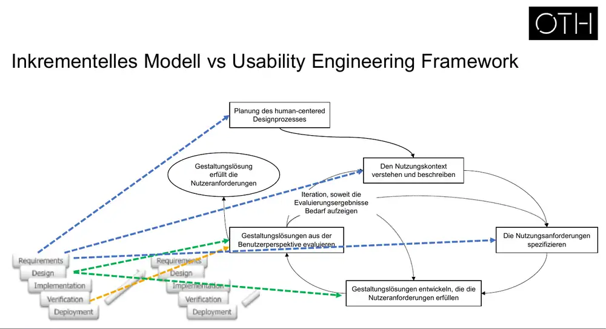
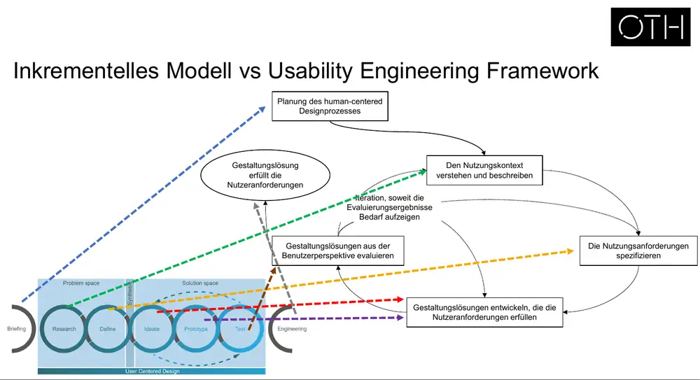

### Design besteht aus Kompromissen (F57)
- Es gibt keine einzelne korrekte Lösung. Entwürfe sind besser oder schlechter, es gibt immer Alternativen. Entschieden wird im Projektkontext.
- Typische Zielkonflikte: schneller Projektfortschritt vs. genauere Problemanalyse; leicht erlernbares System vs. effiziente Nutzung für Experten
- Designentscheidungen werden ständig diskutiert und iterativ angepasst.

### Fazit (F58)
- Usability Engineering beginnt beim Verständnis des Problems, nicht bei der Technik bzw. Lösung.
- Software-Entwicklungsmodelle konkurrieren. Usability Engineering muss sich in sie eingliedern.
- Design ist keine eindeutige Lösung, Kompromisse sind nötig.
- Das UE Framework beschreibt Methoden zur iterativen Entwicklung vom Problem bis zum finalen Design.
- Nicht alles muss oder kann umgesetzt werden. Reale Rahmenbedingungen beeinflussen die Methodenwahl.

## 6. Methoden im Usability Engineering / HCD (F59–77)
- Leitfragen: Know your users! (F60) · Was können und brauchen Ihre Nutzer? (F61) · Was ist Ihr Kontext? (F62; Bilder: Großstadt, Wald, Auto-Cockpit)
- [F63: Wortwolke mit Methoden: competitor analysis, service blueprint, task analysis, cognitive walkthrough, usability testing, prototype, wireframes, shadowing, ethnography, user journey, sketching, diary study, tree testing, survey, contextual inquiry, interview, A/B testing, probing, observation, UEQ, benchmarking, focus group, card sorting, guidelines, low/high fidelity, scenarios, SUS, heuristic evaluation, multivariate testing, experience map …]

### Dimensionen der Methodenwahl (F64–69)
| Dimension | Pol A | Pol B |
|---|---|---|
| Beobachten oder Fragen? | Erhebung durch Beobachtung → **behavioural** | Erhebung durch Beschreibung → **attitudinal** |
| Zahlen oder Stories? | Wie oft kommt etwas vor? → **quantitativ** | Warum kommt etwas vor? → **qualitativ** |
| Laien oder Experten? | Users oder Lead-Users | Expert:innen |
| Labor oder Feld? | Kontrollierte Umgebung | Kontextabhängige Umgebung |
| Eigene Präferenzen | Welche Methode liegt Ihnen? Womit fühlen Sie sich wohl? | |

- Video (F70): „When to use which UX research method“ (NN/g, Kara Pernice) – https://www.youtube.com/watch?v=OtUWbsvCujM

### UX Research Techniques (Christian Rohrer, 2014, F71–72)
Zwei Achsen: **behavioural ↔ attitudinal** (vertikal) und **qualitativ/direkt ↔ quantitativ/indirekt** (horizontal).
- Behavioural + qualitativ: Usability Lab Studies, Ethnographic Field Studies, Eyetracking, Moderated Remote Usability Studies
- Behavioural + quantitativ: Clickstream Analysis, A/B Testing, Usability Benchmarking (Lab), Unmoderated UX Studies, True Intent Studies, Unmoderated Remote Panel Studies
- Attitudinal + qualitativ: Interviews, Focus Groups, Participatory Design, Diary/Camera Studies, Customer Feedback, Concept Testing
- Attitudinal + quantitativ: Intercept Surveys, Email Surveys. Card Sorting und Desirability Studies liegen dazwischen.
- Legende Nutzungskontext: natürliche Nutzung / gescriptet (Labor) / dekontextualisiert (ohne Produkt) / hybrid

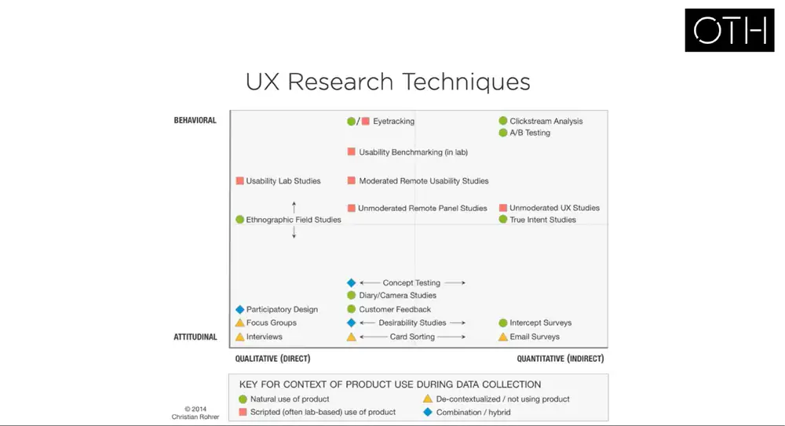

### Szenario → Methode (F73)
Matrix aus Fragestellungen (z. B. „New concept in the industry“, „Stakeholders can't agree“, „The CEO has an idea…“, „Why isn't xxx working?“, „Why poor conversion?“, „Who are our users?“, „How do users really use stuff?“, „Several solutions?“, „What do users think of xxx?“, „We need to start again“, „Organization not user-centric“) gegen Methoden (Usability testing, Content testing, Card sorting, Surveys, User interviews, Diary studies, IA validation, Ethnography, Contextual inquiry, A/B testing, Stakeholder workshops, Guerrilla research). Grau markierte Felder = passende Methode. Details siehe Bild.
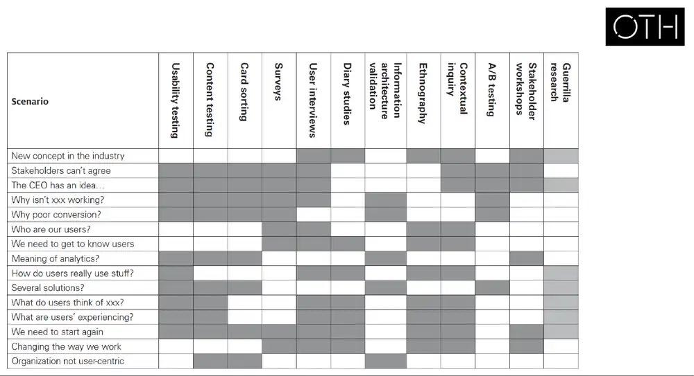

### Methoden nach Entwicklungsphase (F74)
| Phase | Define | Analyse | | Implement | | Evaluate | | |
|---|---|---|---|---|---|---|---|---|
| Intention | Generative | Generative | | Formative | | Summative | | |
| Info-Typ | Attitudinal | Behavioural | | Behavioural | | Attitudinal | Behavioural | |
| Frage | Quant | Qual | Quant | Quant | Qual | Quant | Qual | Quant |
| Methoden | Surveys | User Interviews, Diary Studies, Ethnography, Contextual Inquiry, Stakeholder Workshops, Guerrilla Research | Analytics | A/B Testing, Tree Testing, Card Sorting, Content Testing, Analytics, Metrics | Usability Testing, Content Testing, Card Sorting, Guerrilla Research | Surveys | Usability Testing, Content Testing, Contextual Inquiry, Ethnography, Diary Studies, Guerrilla Research | Usability Benchmarking, Analytics, Metrics, Content Testing, A/B Testing |

### Mögliche Methoden je Prozessschritt (F75) – wichtig fürs Projekt
| Prozessschritt (ISO 9241-210) | Methoden |
|---|---|
| Nutzungskontext verstehen & beschreiben | Interview, Umfrage, Fokusgruppe, Diary Studies, (Feld-)Beobachtung, Contextual Inquiry · Service Blueprint, User Journey Map, Competitor-Analyse, Personas, Task Analysis, User/Task Matrix |
| Nutzungsanforderungen spezifizieren | Anforderungskatalog |
| Gestaltungslösungen entwickeln | Storyboard, Sketching, Tree Testing, Wireframe, Rapid Prototyping, LoFi-Prototyp, Navigationsstruktur, HiFi-Prototyp, Infoarchitektur, Styleguide, Card Sorting |
| Gestaltungslösungen evaluieren | Feedback Capture Grid, System Usability Scale (SUS), A/B-Test, Multivariates Testen, Expert Review, User Experience Questionnaire (UEQ), Usability Test, Heuristische Evaluation, Labortest, Feldtest, Lautes Denken, Cognitive Walkthrough |

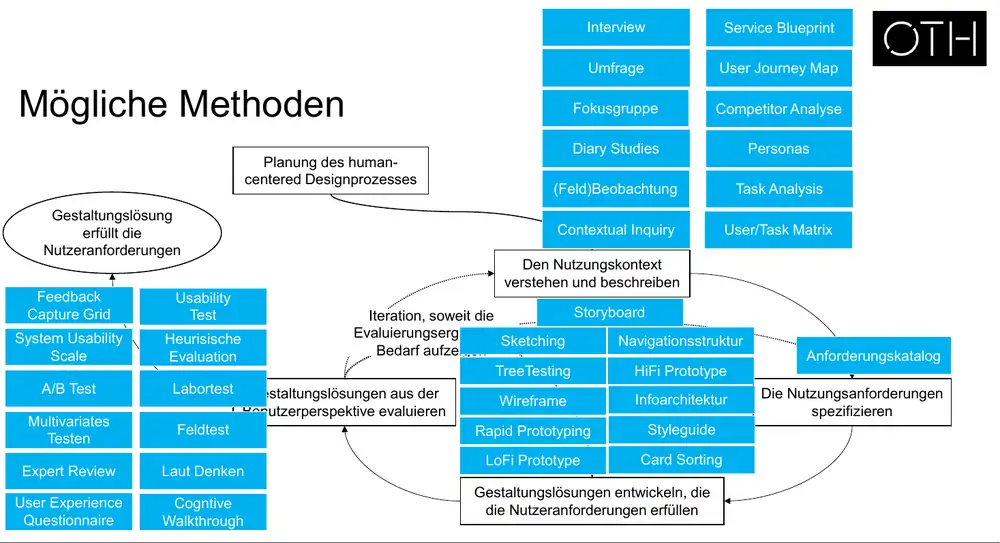

### Mit wie vielen Nutzer:innen testen? (F76)
[Bild: Kurve „Anteil gefundener Usability-Probleme vs. Anzahl Testpersonen“ (0–15). Die Kurve steigt anfangs steil und flacht dann gegen 100 % ab. (Interpretation: bekannte Nielsen/Landauer-Kurve, ca. 85 % der Probleme mit 5 Personen.)]
**VORSICHT:** Das heißt nicht, dass man immer „nur“ mit 5 Personen testen soll!

### Feedback Circles (F77)
Feedback-Quellen in wachsenden Kreisen: Team and friends → Experts → Customers → Customers' Customers.

## 7. Phase 1: Nutzungskontext verstehen und beschreiben (F78–85)
- Wie F42: Benutzer aller Gruppen, Aufgaben, Arbeitsmittel, physischer und sozialer Kontext. Ohne das basiert alles auf Annahmen.

### Elemente des Nutzungskontexts (F81–83)
| Element | Leitfrage |
|---|---|
| Aufgaben und Ziele | Welche Aufgaben und Ziele haben die Nutzer? |
| Ausrüstung | Welche Ausrüstung verwenden die Nutzer? |
| Umgebung | In welcher Umgebung wird das System benutzt? |
| Benutzer | Wer sind die Benutzer? |

Benutzertypen:
- **Primäre Benutzer:** interagieren mit dem System, um die von ihm unterstützten Ziele zu erreichen.
- **Sekundäre Benutzer:** interagieren, um die Nutzung zu unterstützen oder das System zu warten (Sicherheitsmanager, Administrator, Trainer, Wartung).
- **Direkte Benutzer** interagieren mit dem System. **Indirekte Benutzer** nutzen vom System erzeugte Daten (z. B. einen Ausdruck).
- **Stakeholder:** können Benutzer sein oder nicht. Sie gelten nicht als Benutzer, wenn sie vom System beeinflusst werden, aber weder interagieren noch das Arbeitsergebnis nutzen.
- Beispiel auf der Folie (F83): Geldautomat (nur Bild, nicht ausgeführt).

### Ethische Grundregeln für Datenerhebungen (Marsh, 2022, F85)
- Forschung ist transparent und seriös. Team und Teilnehmende verstehen, welche Daten warum gesammelt werden.
- Bedürfnisse von Teilnehmenden, Organisation und einem selbst in Balance halten. Anderen angemessene Anerkennung geben.
- **Nicht schaden:** Rechte, Wohlergehen und Vertraulichkeit respektieren.
- **Informierte Einwilligung** einholen und über Rechte informieren (Anonymität, Löschung der Daten).
- **Daten richtig verwenden:** zweckmäßige, sichere Sammlung und Speicherung; Nutzung nur für den vorgesehenen Zweck.
- **Rechtliche Pflichten:** Datenschutz, DSGVO, Menschenrechte (geschützte Merkmale). Datenschutz-Folgenabschätzung (DPIA) bei hochriskanten Teilnehmenden. Beobachter über ihre Pflichten informieren.

Nächster Termin: 02.11.2026, Raum D003.

---

# Teil 2 (F87–105): Interviews & Planung der Datenerhebung

## Einverständniserklärung (Marsh, 2022, F89–90)
Typische Inhalte:
- Mindestalter 16 oder 18 Jahre (je nach Standort)
- Einschränkungen, z. B. Teilnahme von Agenturen/Dritten bei unmoderierter Remote-Forschung
- Inakzeptables Verhalten, das zu Abbruch ohne Entlohnung führt (beleidigendes Verhalten, Sprachbarrieren, zu viel Hintergrundlärm, falsche Angaben zu Wissen/Fähigkeiten)
- Vertraulichkeit und Geheimhaltung
- Rechtliches und Compliance zu Entlohnungen
- Datenschutzrichtlinie (oder Link), Infos zur Datenspeicherung
- Erforderliche Ausnahmen

[Bild F90: Beispiel einer zweiseitigen Einverständniserklärung (Consent Agreement) mit Projektangaben, Erklärungen zu Aufzeichnung und Transkript, Ankreuzoptionen zur Zitierbarkeit, Unterschriftsfeldern für Teilnehmende und Forschende sowie Kontaktdaten.]

## Primary vs. Secondary Research (F91–92)
| Primary Research (eigene Erhebung) | Secondary Research (Aufbereitung/Analyse) |
|---|---|
| Interview | Szenarios |
| Umfrage | Personas |
| Fokusgruppe | User Journey Map / Service Blueprint / (Experience Map) |
| Diary Study | Empathy Map |
| Contextual Inquiry / Beobachtung / Shadowing | Task Analysis |
| (Ethnographie) | Concept Map |
| | User/Task Matrix |

Zusätzlich: Recherche (Literatur, weiterführend, Benchmarking), Mitbewerberanalyse.
→ Projektrelevant: Jedes Teammitglied führt **eine Primary- und eine Secondary-Methode** durch (siehe HCI_03, Projektbriefing).

## Interviews (F93–104)

**Grundlagen (F94)**
- Datensammlung mit sorgfältig ausgewählten Personen für ein tiefes Verständnis ihrer Tätigkeit. Deckt Gemeinsamkeiten und Unterschiede zwischen Nutzenden auf.
- **Meister-Schüler-Modell:** Der Interviewer ist der Schüler.
- Eher offene als geschlossene Fragen, eher neutrale als suggestive Fragen
- Gut geeignet für Einstellungen, Ansichten, Gefühle. Schlecht geeignet, um präzise vergangene Vorkommnisse zu erfragen.
- Interviewleitfaden vorbereiten, damit alle Themen abgedeckt werden

**Planung (F95)**
- Ziel und Vorgehen planen, passende Stakeholder identifizieren
- Interview definieren: Vorgehen, übergeordnete Fragen. **Interview Guide** mit Einführung, Zustimmungserklärung, Hintergrundinfos, Zeitmanagement und Ort, Interviewfragen, Kommentarbogen
- Nachbereitung definieren, Stakeholder anschreiben

**Durchführung (F96)**
- Angenehme, professionelle Atmosphäre; klare Einführung; durch die relevanten Themen führen
- Transkription klären: Audio-/Videoaufzeichnung, stille Person (Protokollant), stichpunktartige Transkription (Achtung: erschwert die Analyse)
- Reflexionsfragen: Was tun, wenn die Person wenig sagt? Wenn das Thema abdriftet? Wenn die Zeit ausgeht?

**Best Practices (F97)**
- Offene Fragen stellen, Suggestivfragen und Verhörsituation vermeiden, aktiv zuhören üben, „Sie sind nicht der Star!“
- Bias beachten: Selection Bias, Facilitator Bias, Social Desirability Bias

**Analyse (F98)**
- Informelle Inhaltsanalyse: gut für agiles Arbeiten, aber nicht immer ausreichend
- Formale Verfahren: nach Mayring, nach Kuckartz, nach Meuser & Nagel, nach Gläser & Laudel

**Kommunikation (F99)**
- Offen und transparent kommunizieren. Fragen bzw. den Guide vorab schicken.
- Einverständnis zu Audio-/Videoaufnahmen vorab einholen
- Interviewees nicht anlügen (z. B. bei der Zeit). Professionell auftreten, auch rhetorisch.
- Nach Anonymität bei Veröffentlichung fragen
- **Wichtig:** Transkript bzw. Analyse an die Interviewten schicken und finale Zustimmung einholen

**Probing (F100–101)** – Video NN/g: https://www.youtube.com/watch?v=1bionYPAPhg
- Teil anderer Methoden (z. B. Interviews): Folgefragen zu Aussagen → mehr Details, Gedanken, Gefühle, Erzählungen → Nutzerbedürfnisse
- Arten von Probes:
  - **Clarify:** klären, wie man eine Aussage verstanden hat
  - **Detail:** nach weiteren Details fragen
  - **Rationalize:** nach Gründen für Gefühle, Bedürfnisse, Präferenzen fragen
  - **Imaginate:** nach der Nutzung in fiktiven Szenarien fragen
  - **Ideate:** fragen, was gut/schlecht ist, woran man sich erinnert und warum

**Interview Mistakes (F102)** – Video: https://www.youtube.com/watch?v=yBYd5USasXg

**The Demographics Trap (F103):** Zwei Personen mit identischen Demografiedaten (geboren 1948, aufgewachsen in England, zweite Ehe, zwei Kinder, erfolgreich, wohlhabend, Winterurlaub in den Alpen, Hundebesitzer). (Interpretation: Es handelt sich um zwei sehr verschiedene Menschen. Demografie allein beschreibt Nutzende und ihre Bedürfnisse nicht, daher nicht nach Demografie segmentieren.)

**Literatur (F104):** Bogner, Littig & Menz (2009) *Interviewing Experts* · Boyce & Neale (2006) *Conducting In-Depth Interviews* · Guion, Diehl & McDonald (2006) *Conducting an In-depth Interview* · Kvale (2007) *Doing Interviews* · Roulston (2010) *Reflective Interviewing*

## Arbeitsauftrag (F105)
- Problemraum weiter definieren: Wer sind potenzielle Stakeholder (primary, secondary, direct/indirect users)? Welche Orte sind relevant? Welchen Zugriff haben Sie auf Stakeholder und Orte?
- Wie kommen wir an Daten? Wie lässt sich die Erhebung konkretisieren, planen, durchführen? Wie lassen sich die Kontexte untersuchen?
- Machen Interviews Sinn? (Spoiler: JA!) Ziel? Verantwortliche Person? Wer wird interviewt? Konkrete Fragen?

## Quellen (auf den Folien genannt)
British Design Council (2019) · Brink et al. (2010) · DIN EN ISO 9241-210 · Lawson (1980) · Marsh (2022) · Mayhew (2010) · Rohrer (2014) · NN/g-Videos
